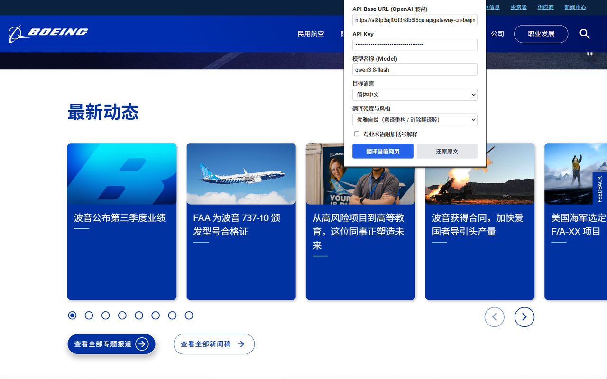

# AI Web Translator

> 当前开发版本：**v1.4.0**

AI Web Translator 是一个 Chrome 浏览器扩展，使用用户自行配置的大模型 API 对整页网页进行原地翻译，并支持 PDF 文档的双语对照翻译，覆盖简体中文、繁体中文、英文、日文、韩文、西班牙文、法文、德文、意大利文、葡萄牙文、俄文、阿拉伯文、泰文、越南文、印尼文与马来文共十六种目标语言。网页译文直接替换页面中的原文，不改变页面排版、链接与交互元素，翻译完成后可一键还原原文。

浏览器内置翻译在处理专业术语与复杂句式时往往不够理想。本扩展将翻译交由用户指定的大模型完成，翻译质量与语言风格均可控。



## 功能特性

- **整页原地翻译**：自动识别页面中的可翻译文本，跳过代码块、输入框、脚本等不应修改的内容，译文保留原有排版。
- **PDF 文档翻译**：拖入本地 PDF 文件或粘贴链接，提取文本层后按段落翻译，原文与译文左右两栏对照呈现（窄屏自动堆叠），可切换为仅译文视图。沿用与网页翻译相同的 API、目标语言、风格与术语解释设置。在 PDF 标签页上点击扩展图标，主按钮会变为「翻译此 PDF」，读取浏览器当前加载的地址并直接进入翻译页；地址不带 `.pdf` 后缀的 PDF（如 arxiv.org/pdf/xxxx）同样可以识别。
- **自定义模型**：支持任何兼容 OpenAI 接口的服务，包括 OpenAI、通义千问、DeepSeek、Kimi 及本地部署的模型。填写地址与密钥后自动获取可用模型列表，API 未提供的模型（含默认模型）自动取消勾选，勾选需要的模型后即可在「翻译模型」下拉中选用；也支持手动添加模型名称，手动添加的模型不会被自动移除。
- **三档翻译风格**：
  - 严谨准确：直译优先，完整保留原文信息，适合技术文档与论文；
  - 均衡标准（默认）：在准确传达原意的前提下，兼顾目标语言的表达习惯；
  - 优雅自然：以意译重构句式，消除生硬的翻译痕迹，适合新闻与博客。
- **术语解释**：可选功能。开启后，译文中的专业术语首次出现时附括号注释，包含原文及一句话释义，便于阅读陌生领域的文章。
- **始终翻译此网站**：按站点记忆。开启后，该网站的页面每次加载时自动翻译，无需手动点击。
- **悬停翻译**：开启后，将鼠标悬停在某段文字上并按住 Ctrl 键，即只翻译该段落，适合长篇页面中的局部阅读。悬停目标以描边标示，翻译完成后描边消失。
- **自动翻译外语页面**：开关文案跟随当前页面语言（如「自动翻译英文页面」「自动翻译中文页面」）。开启后，加载时自动识别页面主语言，与目标语言不同即翻译，与目标语言相同的页面不受影响。
- **一键还原**：原文在内存中保留备份，可随时恢复。
- **进度与错误提示**：翻译按批次并发执行，单批失败不影响其余批次；页面右上角显示完成进度或失败原因。
- **界面跟随目标语言**：面板文案随所选目标语言即时切换，十六种语言均有完整界面译文，阿拉伯语自动采用从右至左排版；页面提示条与面板使用同一语言。

## 安装

### 方式一：Chrome 应用商店（已上架）

前往 [Chrome 应用商店页面](https://chromewebstore.google.com/detail/oiheeklecbofdocnfdbellakbpiphijp?utm_source=item-share-cb)，点击「添加至 Chrome」即可安装。商店版本为已发布的稳定版本，如需体验最新功能，请使用方式二。

### 方式二：手动加载（最新开发版本）

下载本仓库中的 `Ptrans` 文件夹，通过开发者模式加载：

1. 在 Chrome 地址栏输入 `chrome://extensions/` 并回车；
2. 开启右上角的「开发者模式」；
3. 点击「加载已解压的扩展程序」，选择 `Ptrans` 文件夹。

安装完成后，浏览器工具栏将显示扩展图标。

> 注意：安装或更新扩展后，已打开的网页需刷新一次方可翻译；`chrome://` 内部页面与 Chrome 商店页面受浏览器安全策略限制，无法翻译。浏览器内置的 PDF 查看器同样无法注入翻译脚本，PDF 请走「翻译 PDF」入口。

## 使用方法

1. 打开需要翻译的网页；
2. 点击工具栏中的扩展图标；
3. 首次使用需展开面板底部的「API 设置」抽屉，填写以下配置（保存后自动记忆，无需重复填写）：
   - **API Base URL**：API 服务地址，如 `https://api.openai.com/v1`；
   - **API Key**：对应服务的密钥；
   - **可用模型**：填写地址与密钥后自动从 API 获取模型列表，API 未提供的模型（如默认的 `gpt-4o-mini`）会被自动取消勾选，请从列表勾选需要使用的模型（如 `qwen-plus`、`deepseek-chat`），勾选的模型会出现在面板的「翻译模型」下拉中；接口未返回的模型可在列表下方手动输入添加，手动添加的模型不会被自动移除；
4. 在「翻译模型」下拉中选择模型，再选择目标语言与翻译风格，点击「翻译当前网页」；
5. 页面右上角提示条显示翻译进度与结果（完成为绿点、失败为红点）；点击「还原原文」可恢复原文。

### 自动与悬停翻译

面板中的开关均即时保存、即时生效：

- **始终翻译此网站**：将当前站点加入自动翻译名单，此后访问该站点的任何页面都会在加载时自动翻译；再次取消勾选即移除。名单按站点（域名）记录，可在各站点分别开关。
- **悬停段落，按住 Ctrl 翻译**：开启后，鼠标悬停于某段文字并按住 Ctrl 键约四分之一秒，即翻译该段落。已翻译或正在翻译的段落不会重复请求；焦点位于输入框时不触发，以免与编辑快捷键冲突。
- **自动翻译外语页面**：开关文案按当前页面检测出的语言动态生成（如目标语言为英语、当前页为中文时显示「自动翻译中文页面」）。开启后，页面加载时若判定页面主语言与目标语言不同，则自动翻译；页面语言与目标语言相同或无法判定时不触发。页面语言检测不到时（如 chrome:// 内部页面），文案回退为「自动翻译外语页面」。

自动翻译（含站点名单与外语页面两项）要求已填写 API Key，或 API 地址指向本机服务（如 Ollama），以避免未配置完成时发起无效请求。

### PDF 文档翻译

1. 点击面板底部的「翻译 PDF」卡片，打开翻译页；
2. 拖入本地 PDF 文件（或点击虚线框选择），也可以粘贴 PDF 链接后点击「加载链接」；
3. 解析与翻译进度实时显示，完成后按页呈现左右对照：左栏灰色小字为原文，右栏正文为译文；
4. 顶部可切换「双语对照 / 仅译文」；在弹窗中修改目标语言或风格后，点击「重新翻译」即按新设置重译。

PDF 翻译复用网页翻译的全部配置与批处理管线。若当前标签页本身就是 PDF，直接点击「翻译当前网页」也会跳转到翻译页并自动加载该链接：地址以 `.pdf` 结尾时直接判定；否则在内容脚本无法注入时向该地址发送一次 HEAD 请求，按响应 Content-Type 判定。

本地文件最简方式是直接拖入翻译页。在浏览器中打开的本地 PDF（`file://` 地址）也可以经按钮带入翻译页，但读取本地文件需要先在 `chrome://extensions` 为本扩展开启「允许访问文件网址」；未开启时翻译页会给出开启指引，拖入文件则不受此限制。

### 常见 API 配置示例

| 服务 | Base URL | 模型示例 |
|---|---|---|
| OpenAI | `https://api.openai.com/v1` | `gpt-4o-mini` |
| 阿里云百炼（通义千问） | `https://dashscope.aliyuncs.com/compatible-mode/v1` | `qwen-plus` |
| DeepSeek | `https://api.deepseek.com/v1` | `deepseek-chat` |
| 月之暗面 Kimi | `https://api.moonshot.cn/v1` | `moonshot-v1-8k` |
| 本地 Ollama | `http://localhost:11434/v1` | `qwen2.5:7b` |

任何兼容 OpenAI `/chat/completions` 接口的服务均可使用。

## 工作原理

1. 扫描页面中的文本节点，过滤代码、输入框等不可翻译内容；
2. 每 20 段文本打包为一批，最多 3 批并发请求所配置的 API；
3. 模型返回译文后原地替换文本，保留首尾空白与原有排版；
4. 原文保留于内存中，供一键还原使用。

PDF 翻译走同一套批处理管线，前置步骤为：内置的 PDF.js 提取各页文本层，按坐标聚行、按行距切段，过滤页码等纯数字内容，再将段落送入翻译队列。

## 隐私说明

- API Key 仅保存于浏览器本地存储，不上传至任何第三方服务器；
- 网页与 PDF 内容仅发送至用户自行配置的 API 地址；PDF 链接的下载请求仅指向用户提供的地址；为识别当前标签页是否为 PDF，可能向该标签页已加载的地址发送一次 HEAD 请求（不下载正文）；除此之外扩展不发起其他网络请求；
- 无统计、无遥测、无账号体系；
- 完整隐私政策见 [privacy_policy.html](https://wolfpan.github.io/ptrans/store_assets/privacy_policy.html)。

## 已知限制

- 仅翻译文本节点，不识别图片中的文字；扫描版 PDF（纯图片、无文本层）同样无法翻译，加载时会明确提示；
- PDF 翻译以双语对照文档呈现，不保留原始版面（图表、公式与多栏排版会被展平为段落）；受密码保护的 PDF 暂不支持；
- 动态加载的内容（如无限滚动新增部分）需再次点击翻译；
- 自动翻译在页面加载时判定一次；单页应用内部跳转（地址变化但不重新加载）不会重新触发；
- 页面语言识别基于字符脚本与功能词词频的启发式判断，多语混排页面可能判定不准，此类页面建议手动翻译；
- 所选模型需支持 JSON 输出（`response_format`），主流服务均已支持；
- 长页面会消耗较多 token，请留意 API 额度。

## 项目结构

```
Ptrans/           扩展本体（手动加载时选择该文件夹）
├── manifest.json   扩展配置
├── background.js   后台脚本，负责调用 API
├── content.js      内容脚本，负责文本提取与替换
├── popup.html/js   设置面板
├── pdf.html/js     PDF 翻译页（文本层提取与双语对照渲染）
├── vendor/         PDF.js 4.10.38（Apache-2.0，未修改）
└── icons/          图标
store_assets/     Chrome 商店上架素材与隐私政策
```

## 开源协议

本项目采用 GPLv3 协议。使用者可自由使用、修改与分发本软件；但分发修改后的版本时，须同样以 GPLv3 协议公开源代码，不得将其用于闭源的商业衍生版本。个人使用及组织内部使用不受上述限制。完整条款见 [LICENSE](LICENSE)。

内置的 [PDF.js](https://mozilla.github.io/pdf.js/)（`Ptrans/vendor/`，pdfjs-dist 4.10.38）为 Mozilla Foundation 出品的第三方组件，采用 Apache-2.0 协议，未做修改，许可声明保留于文件头部；Apache-2.0 与 GPLv3 单向兼容，不影响本项目的整体授权。