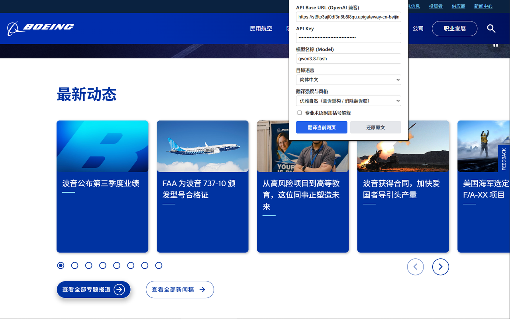

# AI Web Translator

一个 Chrome 浏览器扩展：**用你自己的大模型 API，一键把整个网页翻译成中文**（也支持英文、日文）。

翻译直接发生在原网页上——按钮、链接、排版都不动，只是文字变成了你看得懂的语言。看完还能一键还原原文。



## 它解决什么问题？

浏览器自带的翻译是"机器味"的：术语乱翻、句子生硬、专业内容经常翻车。这个扩展把翻译工作交给你指定的大模型（GPT、通义千问、DeepSeek……任何兼容 OpenAI 接口的服务都行），翻译质量由你选的模型决定，还能调风格：

- **严谨准确**：直译优先，一个信息点都不丢，适合读文档、论文
- **均衡标准**（默认）：准确，同时读起来像人话
- **优雅自然**：意译重构，彻底消除翻译腔，适合读博客、新闻

还有一个可选功能：**专业术语括号解释**。勾选后，译文里的术语会带上原文和一句话解释，比如"注意力机制（Attention，让模型学会该重点看输入哪部分的机制）"——读陌生领域的文章时特别有用。

## 安装

### 方式一：Chrome 应用商店

商店版正在审核中，上架后搜索 **AI Web Translator** 即可安装。审核期间请用方式二。

### 方式二：手动加载

1. 下载本仓库，解压
2. 打开 Chrome，地址栏输入 `chrome://extensions/` 回车
3. 打开右上角的「开发者模式」开关
4. 点「加载已解压的扩展程序」，选择仓库里的 `Ptrans` 文件夹

装好后浏览器工具栏会出现扩展图标。

> 注意：安装或更新扩展后，**已经打开的网页需要刷新一次**才能翻译。`chrome://` 开头的浏览器内部页面和商店页面无法翻译，这是 Chrome 的安全限制。

## 使用

1. 打开你想翻译的网页
2. 点击工具栏上的扩展图标
3. 第一次使用需要填三样东西（填一次就行，之后自动记住）：
   - **API Base URL**：你的 API 服务地址，比如 `https://api.openai.com/v1`
   - **API Key**：你的密钥
   - **模型名称**：比如 `gpt-4o-mini`、`qwen-plus`、`deepseek-chat`
4. 选好目标语言和翻译风格，点「**翻译当前网页**」
5. 页面右上角会弹出进度提示，翻完显示绿色提示条；想回去看原文就点「**还原原文**」

### 常见 API 配置示例

| 服务 | Base URL | 模型示例 |
|---|---|---|
| OpenAI | `https://api.openai.com/v1` | `gpt-4o-mini` |
| 阿里云百炼（通义千问） | `https://dashscope.aliyuncs.com/compatible-mode/v1` | `qwen-plus` |
| DeepSeek | `https://api.deepseek.com/v1` | `deepseek-chat` |
| 月之暗面 Kimi | `https://api.moonshot.cn/v1` | `moonshot-v1-8k` |
| 本地 Ollama | `http://localhost:11434/v1` | `qwen2.5:7b` |

任何兼容 OpenAI `/chat/completions` 接口的服务都能用，包括各种中转站。

## 它是怎么工作的？

简单来说：

1. 扫描网页里的所有文字（自动跳过代码块、输入框、脚本这些不该动的地方）
2. 每 20 段打包成一批，最多 3 批同时发给你的 API
3. 模型返回译文后，原地替换文字，保留原有排版
4. 原文在内存里留了底，所以随时能一键还原

翻译过程中某一批失败了不会连累其他批次，页面右上角会告诉你失败原因和完成进度。

## 隐私说明

- 你的 API Key **只存在你自己浏览器的本地存储里**，不会上传到任何第三方服务器
- 网页内容只会发送到**你自己填写的那个 API 地址**，除此之外没有任何网络请求
- 没有统计、没有遥测、没有账号体系
- 完整隐私政策见 [privacy_policy.html](https://wolfpan.github.io/ptrans/store_assets/privacy_policy.html)

## 已知限制

- 翻译按文本段进行，不处理图片里的文字
- 动态加载的内容（比如无限滚动刷出来的新内容）需要再点一次翻译
- 翻译质量取决于你选的模型；模型需要支持 JSON 输出（`response_format`），主流服务都支持
- 长网页会消耗较多 token，注意你的 API 额度

## 项目结构

```
Ptrans/           扩展本体（加载这个文件夹即可）
├── manifest.json   扩展配置
├── background.js   调用 API 的后台脚本
├── content.js      注入网页、替换文字的脚本
├── popup.html/js   点击图标弹出的设置面板
└── icons/          图标
store_assets/     Chrome 商店上架素材与隐私政策
```

## 开源协议

本项目采用 **GPLv3**。说白了：你可以随便用、随便改、随便分发，但如果你把改过的版本发给别人，就必须同样以 GPLv3 公开源码——不能拿去做闭源商业版。自己用、公司内部用不受任何限制。完整条款见 [LICENSE](LICENSE)。

